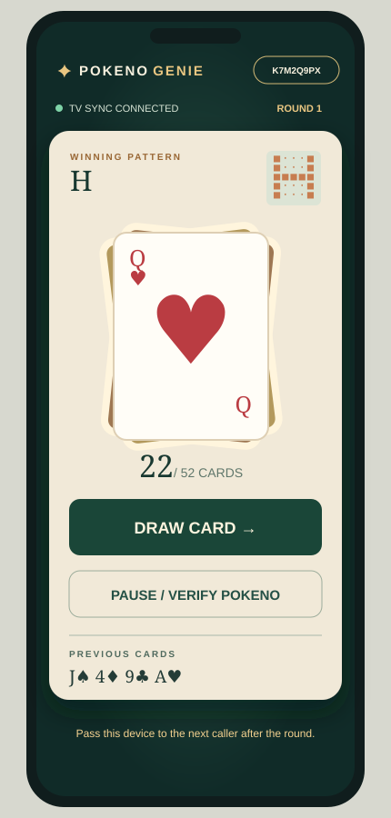
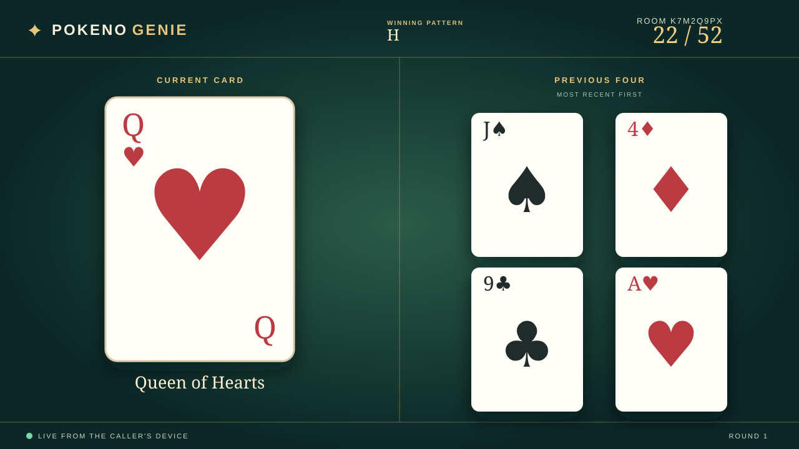

# Pokeno Genie

A free, live Pokeno card caller for one shared phone or tablet and a separate TV browser. Players use their physical 5×5 boards. The caller picks a preset winning pattern, starts a freshly shuffled 52-card deck, and draws cards at least three seconds apart. The TV shows the current card and four previous cards.

The caller app is a .NET 10 Blazor WebAssembly solution for Visual Studio. A lightweight `tv.html` display supports TV browsers that cannot start Blazor. GitHub Pages serves the static files; Firebase Realtime Database on the no-cost Spark plan synchronizes the two screens. No paid account, image service, or hosted C# server is needed. See [DEPLOYMENT.md](DEPLOYMENT.md) for the full setup and deployment steps.

## Screen mockups

**Caller phone**



**TV display**



## Game flow

1. On the phone, open the site and create a table. Keep this browser's data so the caller identity persists between rounds.
2. Open the site's `tv.html` page on the TV and enter the eight-character table code.
3. Choose a pattern and select **Shuffle & start round**. The pattern locks for that round.
4. Select **Draw card** to reveal each card. Number cards show their suit pips, and Jacks, Queens, and Kings have illustrated faces (car artwork in the MOPAR deck). The button unlocks after three seconds. The TV updates live.
5. In **Card deck**, choose Illustrated, Midnight, Sunburst, MOPAR Muscle, or 1969 Dart. The caller and TV switch together without changing the current round or card order. The choice remains in effect for later rounds at that table.
6. If a player calls Pokeno, choose **Pause / verify Pokeno** and review the full called-card history. Resume or end the round manually.
7. To begin with a fresh room code and round count, choose **End table & start new** on the caller phone. Enter the new code on the TV.

Preset patterns: standard bingo (any row, column, or diagonal), horizontal, vertical, diagonal, H, C (opens right), X, plus, four corners, perimeter, and full board. The picker previews patterns on hover, keyboard focus, and tap.

## Solution layout

- `src/PokenoGenie` — responsive Blazor caller interface, Firebase browser bridge, and lightweight TV display.
- `src/PokenoGenie/wwwroot/cards` — five bundled sets of 52 SVG faces shared by the caller and TV. Run `node tools/generate-card-art.mjs` to regenerate them. MOPAR Muscle includes separate Charger, Challenger, ’Cuda, and Superbird illustrations, with each model on 13 cards and all four on the back. The blue Dart illustration is inspired by the supplied reference photo. Artwork sources are recorded in [docs/CARD-ART.md](docs/CARD-ART.md). To add another bundled theme, add its assets and ID to `DeckThemeCatalog.cs`, `firebase-bridge.js`, `tv.js`, and `database.rules.json`.
- `src/PokenoGenie.Core` — cards, secure shuffle, room codes, and pattern definitions.
- `tests/PokenoGenie.Tests` — C# game-rule tests.
- `tests/firebase` and `database.rules.json` — Realtime Database security-rule tests and policy.
- `.github/workflows/pages.yml` — verification and GitHub Pages deployment.

## Local development

Install the [.NET 10 SDK](https://dotnet.microsoft.com/download/dotnet/10.0) or [Visual Studio Community](https://visualstudio.microsoft.com/vs/community/) with the ASP.NET/web workload. Follow [DEPLOYMENT.md](DEPLOYMENT.md) to create the free Firebase project and copy its web settings into the ignored `src/PokenoGenie/wwwroot/firebase-config.json` file. Then open `PokenoGenie.slnx` in Visual Studio or run:

```powershell
dotnet run --project src/PokenoGenie/PokenoGenie.csproj
```

Run C# tests with `dotnet test PokenoGenie.slnx`. Firebase rule tests additionally need Node.js, pnpm, and Java 21; the deployment workflow runs both suites automatically.
